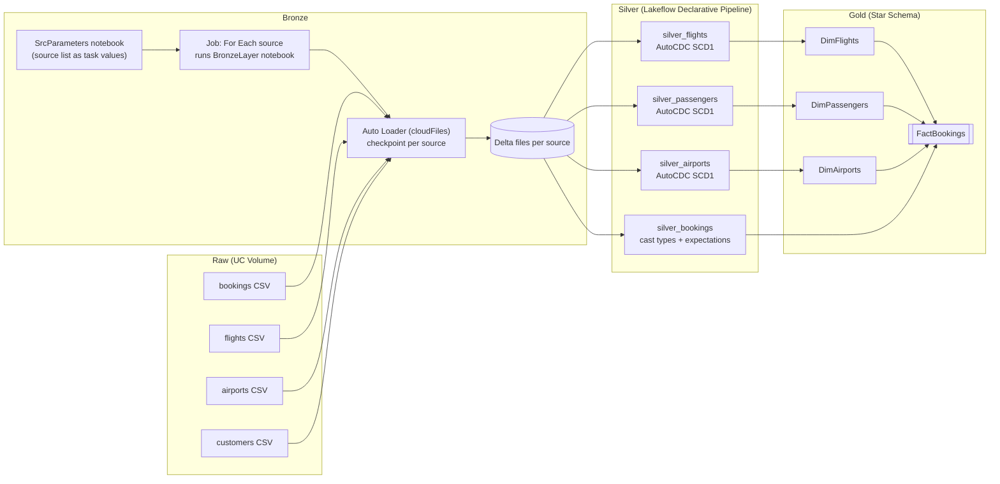
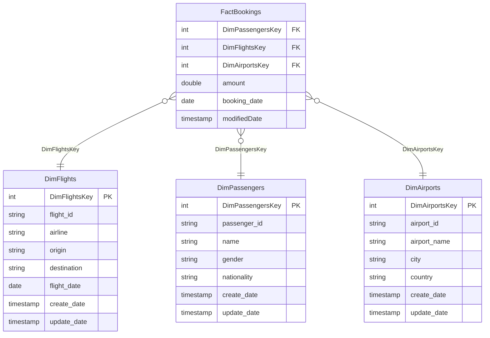

# End-to-End Flights Data Engineering Pipeline on Databricks

An incremental, idempotent **medallion-architecture** pipeline (Bronze → Silver → Gold) built on Databricks. It ingests raw flight-booking CSVs, cleans and deduplicates them with Lakeflow Declarative Pipelines, and publishes a **star schema** (one fact table, three dimension tables) with surrogate keys, ready for analytics.


---

## Table of Contents

1. [Project Overview](#1-project-overview)
2. [Architecture](#2-architecture)
3. [Tech Stack](#3-tech-stack)
4. [Dataset and Data Model](#4-dataset-and-data-model)
5. [Repository Structure](#5-repository-structure)
6. [Pipeline Walkthrough](#6-pipeline-walkthrough)
   - [Step 0: Environment setup](#step-0-environment-setup)
   - [Step 1: Bronze layer (Auto Loader)](#step-1-bronze-layer-auto-loader)
   - [Step 2: Making ingestion dynamic (parameters and Job)](#step-2-making-ingestion-dynamic-parameters-and-job)
   - [Step 3: Silver layer (Lakeflow Declarative Pipelines)](#step-3-silver-layer-lakeflow-declarative-pipelines)
   - [Step 4: Gold dimensions](#step-4-gold-dimensions)
   - [Step 5: Gold fact table](#step-5-gold-fact-table)
7. [Idempotency and Incremental Processing](#7-idempotency-and-incremental-processing)
8. [How to Run](#8-how-to-run)
9. [Design Decisions and Trade-offs](#9-design-decisions-and-trade-offs)
10. [Challenges and Learnings](#10-challenges-and-learnings)
11. [Future Improvements](#11-future-improvements)

---

## 1. Project Overview

**Goal:** Build a production-style data pipeline for flight bookings that handles both an **initial load** and **incremental loads** (new records, updated records, and changed dimension rows) without ever producing duplicates.

**What the pipeline does:**

- Lands raw CSV files in a Unity Catalog **Volume**, one folder per source.
- **Bronze:** ingests files incrementally with Databricks **Auto Loader**, tracking already-processed files with checkpoints.
- **Silver:** cleans, type-casts and validates data with **Lakeflow Declarative Pipelines** (DLT), and applies **AutoCDC** to upsert dimension changes.
- **Gold:** builds a dimensional model with **surrogate keys** and **incremental MERGE** logic, driven by reusable parameterised notebooks.

---

## 2. Architecture



**Unity Catalog layout**

| Layer | Location | Contents |
|-------|----------|----------|
| Raw | `flights_db.rawdata` → volume `rawvolume/raw_data/{airports,bookings,customers,flights}` | Source CSV files (initial + incremental) |
| Bronze | `flights_db.bronze` → volume `bronzevolume/{src}/data` and `/{src}/checkpoint` | Delta data + Auto Loader checkpoints |
| Silver | `flights_db.silver` | `silver_bookings`, `silver_flights`, `silver_passengers`, `silver_airports` |
| Gold | `flights_db.gold` | `DimFlights`, `DimPassengers`, `DimAirports`, `FactBookings` |

---

## 3. Tech Stack

| Area | Technology |
|------|-----------|
| Platform | Databricks (serverless compute) |
| Governance and storage | Unity Catalog, Volumes, Delta Lake |
| Ingestion | Auto Loader (`cloudFiles`), Structured Streaming with `trigger(once=True)` |
| Transformation | PySpark, Spark SQL |
| Silver pipeline | Lakeflow Declarative Pipelines (DLT), `create_auto_cdc_flow`, data quality expectations |
| Orchestration | Databricks Jobs (task values + For Each task) |
| Gold upserts | Delta Lake `MERGE` via `DeltaTable` API |

---

## 4. Dataset and Data Model

Synthetic flight-booking data delivered as CSVs, with **four entities**, plus **incremental** files and **changed-dimension (SCD)** files used to test updates.

### Fact table: `fact_bookings`

| booking_id | passenger_id | flight_id | airport_id | amount | booking_date |
|-----------|--------------|-----------|-----------|--------|--------------|
| B00001 | P0048 | F0014 | A048 | 850.72 | 29-05-2025 |

### Dimension tables

**`dim_flights`**

| flight_id | airline | origin | destination | flight_date |
|-----------|---------|--------|-------------|-------------|
| F0001 | Delta | Kellyfort | South Kathleen | 04-05-2025 |

**`dim_airports`**

| airport_id | airport_name | city | country |
|-----------|--------------|------|---------|
| A001 | Gregoryland International Airport | Kristenmouth | South Georgia and the South Sandwich Islands |

**`dim_passengers`**

| passenger_id | name | gender | nationality |
|--------------|------|--------|-------------|
| P0001 | Kevin Ferguson | Male | Reunion |

> **Naming note:** the raw source folder is called `customers`, but the dimension is modelled and named **passengers** (`silver_passengers`, `DimPassengers`).

### Gold star schema



---

## 5. Repository Structure

```
.
├── README.md
├── notebooks/
│   ├── Setup.py            # Volume / schema creation and ad-hoc checks
│   ├── SrcParameters.py    # Defines the source list and publishes it as a job task value
│   ├── BronzeLayer.py      # Parameterised Auto Loader ingestion (one source per run)
│   ├── dltPipeline.py      # Silver: Lakeflow Declarative Pipeline (all 4 entities)
│   ├── Gold_Dims.py        # Gold: parameterised, incremental dimension builder
│   └── Gold_Fact.py        # Gold: dynamic fact-table builder
└── images/
    ├── job_run.png         # Bronze job screenshot
    ├── silver_pipeline.png # Silver pipeline graph
    └── ...                 # add more screenshots here
```

---

## 6. Pipeline Walkthrough

### Step 0: Environment setup

*File: `Setup.py`*

Created the catalog `flights_db`, with schemas `rawdata`, `bronze`, `silver` and `gold`, and a managed volume for raw files. Inside the raw volume, four directories hold the source files, and the initial CSVs were uploaded into them.

```sql
create volume flights_db.rawdata.rawvolume;
create schema flights_db.gold;
```

```python
dbutils.fs.mkdirs("/Volumes/flights_db/rawdata/rawvolume/raw_data/airports")
# repeated for bookings, customers, flights
```

### Step 1: Bronze layer (Auto Loader)

*File: `BronzeLayer.py`*

Bronze is a raw, append-only copy of the source files. **Auto Loader** (`cloudFiles`) discovers new files and records which ones it has processed in a checkpoint, so re-running the notebook never re-ingests old files.

```python
dbutils.widgets.text("src", "")
src_value = dbutils.widgets.get("src")

df = (spark.readStream.format("cloudFiles")
      .option("cloudFiles.format", "csv")
      .option("cloudFiles.schemaLocation", f"/Volumes/flights_db/bronze/bronzevolume/{src_value}/checkpoint")
      .option("cloudFiles.schemaEvolutionMode", "rescue")
      .load(f"/Volumes/flights_db/rawdata/rawvolume/raw_data/{src_value}/"))

(df.writeStream.format("delta")
   .outputMode("append")
   .trigger(once=True)
   .option("checkpointLocation", f"/Volumes/flights_db/bronze/bronzevolume/{src_value}/checkpoint")
   .option("path", f"/Volumes/flights_db/bronze/bronzevolume/{src_value}/data")
   .start())
```

Key choices:

- **`trigger(once=True)`**: processes everything currently available and stops, giving batch-style, cost-efficient runs.
- **`schemaEvolutionMode = rescue`**: unexpected or mismatched columns land in `_rescued_data` rather than breaking the pipeline.
- **One checkpoint per source**: each entity tracks its own progress independently.

**Validation performed:** ran the notebook several times against the initial files and then against incremental files. Only new files were processed and no duplicate records appeared in bronze.

### Step 2: Making ingestion dynamic (parameters and Job)

*Files: `SrcParameters.py`, `BronzeLayer.py`*

Instead of one notebook per source, the bronze notebook takes a `src` **widget parameter**. A small notebook, `SrcParameters`, defines the list of sources and publishes it as a **job task value**:

```python
src_array = [
    {"src": "bookings"},
    {"src": "airports"},
    {"src": "customers"},
    {"src": "flights"},
]

dbutils.jobs.taskValues.set(key="output_key", value=src_array)
```

A Databricks **Job** runs `SrcParameters` first and then loops over its output, executing `BronzeLayer` once per source with the matching `src` value. Adding a new source later only means adding one entry to the list.


**Validation performed:** ran the job on the initial files, uploaded the remaining (incremental and changed) files to the volume, and re-ran the job. All four sources loaded into bronze correctly.

### Step 3: Silver layer (Lakeflow Declarative Pipelines)

*File: `dltPipeline.py`*

Silver is a single Lakeflow Declarative Pipeline (DLT) that reads the bronze Delta data as streams.


**Bookings (fact source)**

`stage_bookings` (streaming table) → `trans_bookings` (view) → `silver_bookings` (streaming table)

- Casts `amount` to `double` and `booking_date` to `date`
- Adds a `modifiedDate` processing timestamp
- Drops `_rescued_data`
- Enforces **data quality expectations**; rows violating them are dropped:

```python
rules = {
    "rule1": "booking_id IS NOT NULL",
    "rule2": "passenger_id IS NOT NULL",
}

@dlt.table(name="silver_bookings")
@dlt.expect_all_or_drop(rules)
def silver_bookings():
    return dlt.read_stream("trans_bookings")
```

**Dimensions (flights, passengers, airports)**

Each has a `trans_*` view that adds a modified-timestamp column, followed by an **AutoCDC** flow that upserts into a streaming table:

```python
dlt.create_streaming_table("silver_flights")

dlt.create_auto_cdc_flow(
    target="silver_flights",
    source="trans_flights",
    keys=["flight_id"],
    sequence_by=col("F_modifiedDate"),
    stored_as_scd_type=1,
)
```

| Silver table | Key | Sequence column |
|--------------|-----|-----------------|
| `silver_flights` | `flight_id` | `F_modifiedDate` |
| `silver_passengers` | `passenger_id` | `P_modifiedDate` |
| `silver_airports` | `airport_id` | `A_modifiedDate` |

> The pipeline also contains a `silver_business` table that joins all four silver tables. It was created as a **trial/exploration view** and is not part of the gold build.

**Validation performed:** ran the full pipeline, then re-ran it after new data arrived, confirming that upserts update changed dimension rows and that re-runs do not create duplicates.

### Step 4: Gold dimensions

*File: `Gold_Dims.py`*

One reusable, **parameter-driven notebook** builds all three dimensions. The parameter cell defines everything that differs per dimension:

```python
catalog        = "flights_db"
key_cols_list  = ['flight_id']
cdc_col        = "f_modifiedDate"
source_object  = "silver_flights"
source_schema  = "silver"
target_schema  = "gold"
target_object  = "Dimflights"
surrogate_key  = "DimFlightsKey"
backdated_refresh = ""      # optional manual start timestamp
```

The parameter blocks for `DimAirports` and `DimPassengers` are kept in the notebook as commented-out cells. The notebook was run **once per dimension**, swapping in the relevant block each time, so all three share exactly the same logic.

**Logic (incremental, SCD Type 1)**

1. **Last load date:** `max(cdc_col)` from the gold table, or `1900-01-01` if the table does not exist yet. A `backdated_refresh` value can override this to reprocess history.
2. **Read changes:** select silver rows where `cdc_col >= last_load`.
3. **Old vs new:** left join the changes to the existing gold table on the business key.
   - Surrogate key found → **existing record** → refresh `update_date`
   - Surrogate key missing → **new record** → assign a new surrogate key and set `create_date` and `update_date`
4. **Surrogate keys:** `max(existing key) + 1 + monotonically_increasing_id()`, so keys are unique and continue from the last load.
5. **Upsert:** union old and new, then `MERGE` on the surrogate key, updating only when the incoming `cdc_col >= target cdc_col`. On the first run the table is simply created by an append write.

```python
dlt_obj.alias("trg").merge(df_union.alias("src"), f"trg.{surrogate_key} = src.{surrogate_key}") \
       .whenMatchedUpdateAll(condition=f"src.{cdc_col} >= trg.{cdc_col}") \
       .whenNotMatchedInsertAll() \
       .execute()
```

### Step 5: Gold fact table

*File: `Gold_Fact.py`*

The fact notebook is also configuration-driven. A `dimensions` list describes each dimension (table, alias, join keys), and a function **generates the SQL dynamically**:

```python
dimensions = [
    {"table": "flights_db.gold.DimPassengers", "alias": "DimPassengers", "join_keys": [("passenger_id", "passenger_id")]},
    {"table": "flights_db.gold.DimFlights",     "alias": "DimFlights",     "join_keys": [("flight_id", "flight_id")]},
    {"table": "flights_db.gold.DimAirports",    "alias": "DimAirports",    "join_keys": [("airport_id", "airport_id")]},
]
fact_columns = ["amount", "booking_date", "modifiedDate"]
```

The generated query:

- Selects the fact columns plus each dimension's **surrogate key**
- `LEFT JOIN`s every dimension on its business key
- Filters incrementally using `modifiedDate >= last_load`

Before writing, the result is **de-duplicated** with `row_number()` over the three surrogate keys (latest `modifiedDate` wins), so each target row is matched by at most one source row. The final `MERGE` uses the combination of `DimPassengersKey`, `DimFlightsKey` and `DimAirportsKey` as its key.

---

## 7. Idempotency and Incremental Processing

Every layer was tested by running it multiple times with the same and new data.

| Layer | Mechanism | Result |
|-------|-----------|--------|
| Bronze | Auto Loader file-tracking checkpoints | Already-seen files are skipped |
| Silver | AutoCDC keyed upserts (dimensions); expectations (bookings) | Changed rows updated in place, no duplicates, bad rows dropped |
| Gold dims | Last-load watermark + `MERGE` on surrogate key | Existing rows updated, new rows inserted with new keys |
| Gold fact | Watermark + de-duplication + `MERGE` on surrogate-key combination | Re-runs update rather than duplicate |

---

## 8. How to Run

**Prerequisites:** a Databricks workspace with Unity Catalog and serverless (or standard) compute.

1. **Create objects:** run `Setup.py` cells to create the volume, schemas and raw directories. Make sure `flights_db.rawdata`, `flights_db.bronze`, `flights_db.silver` and `flights_db.gold` exist, along with a `bronzevolume` volume in the bronze schema.
2. **Upload data:** place the initial CSVs into `raw_data/airports`, `bookings`, `customers` and `flights`.
3. **Bronze job:** create a Job with:
   - Task 1: notebook `SrcParameters`
   - Task 2: a **For Each** task over `{{tasks.Parameters.values.output_key}}` that runs `BronzeLayer` with the parameter `src = {{input.src}}` (adjust the task name to match yours)
4. **Silver pipeline:** create a Lakeflow Declarative Pipeline using `dltPipeline.py`, target catalog `flights_db`, target schema `silver`. Run it.
5. **Gold dimensions:** open `Gold_Dims.py`, set the parameter block for the dimension you want, and run all cells. Repeat for each of the three dimensions.
6. **Gold fact:** run `Gold_Fact.py` after all three dimensions exist.
7. **Incremental test:** upload the incremental and changed-dimension files, then re-run steps 3 to 6.

---

## 9. Design Decisions and Trade-offs

- **Parameterised notebooks over copy-paste:** one bronze notebook and one gold-dimension notebook serve every entity. Fewer places for bugs and easy to extend.
- **`trigger(once=True)` Auto Loader:** batch-style cost profile with streaming-grade file tracking.
- **`rescue` schema mode:** schema drift never crashes ingestion.
- **AutoCDC for silver dimensions:** declarative upserts instead of hand-written merge code.
- **SCD Type 1:** dimension changes overwrite the previous values; history is not retained.
- **Surrogate keys via `max + monotonically_increasing_id()`:** keys are unique and stable once assigned, but **not contiguous** (gaps are expected).
- **Dynamic SQL for the fact table:** adding another dimension only requires a new entry in the `dimensions` list.

---

## 10. Challenges and Learnings

- **Reading from DLT objects:** inside the pipeline, upstream tables and views must be read with `dlt.read_stream(...)` so dependencies are tracked correctly in the pipeline graph.
- **Debugging gold logic:** several errors in the gold notebooks were diagnosed and fixed with **Databricks Genie**.
- **Merge correctness:** de-duplicating the source before `MERGE` avoids multiple source rows matching one target row.
- **Tracking changes:** having both a processing timestamp in silver and a `create_date`/`update_date` pair in gold makes it easy to see when each record first appeared and last changed.
- **First hands-on experience with** Databricks Jobs (task values and looping), Lakeflow Declarative Pipelines and AutoCDC.

---

## 11. Future Improvements

- Run the gold dimension notebooks as parallel tasks inside a Databricks Job (or with a For Each task) instead of manual parameter swapping, and chain bronze → silver → gold in a single scheduled workflow.
- Move to **SCD Type 2** for dimensions where history matters (for example, a passenger's nationality changing).
- Carry `booking_id` into `FactBookings` as a degenerate dimension and use it as the merge key, so multiple bookings by the same passenger on the same flight are never collapsed into one row.
- Replace `monotonically_increasing_id()` with an identity column for contiguous surrogate keys.
- Add a date dimension and BI dashboards (Databricks AI/BI) on top of the gold layer.
- Add automated data-quality tests and alerting.

---

## Author

**[Your Name]** | [LinkedIn](https://www.linkedin.com/) | [GitHub](https://github.com/)
Feel free to open an issue or connect if you have questions about the project.
